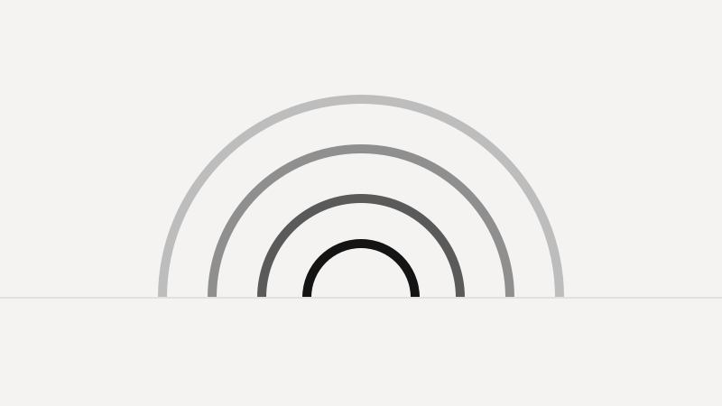

::: {.dropcap}
This is the opening paragraph, and its first letter is set as a **drop cap** — a small
nod to the print magazines this site borrows from. The page uses a warm paper
background, your browser's own default font (no web fonts to download), and a narrow reading measure so long-form
text stays comfortable to read.
:::

Notice the margin to the right: footnotes and references live out there as *side
notes*,^[Like this one. Side notes come from `reference-location: margin` — set once
in `_quarto.yml`, so every footnote you write becomes a margin note automatically.]
rather than collecting at the bottom of the page.

## A dithered image

Add the `.dither` class to any image for a low-tech duotone look. For *true* dithering
(much smaller files, that classic grainy texture), pre-process the image with
`scripts/dither.sh` before dropping it in.

{.dither fig-alt="Abstract placeholder graphic rendered in duotone."}

## Math and code still work

Inline math such as $e^{i\pi} + 1 = 0$ renders, and so do display equations:

$$ \int_0^1 x^2 \, dx = \frac{1}{3}. $$

Static (non-executed) code blocks are syntax-highlighted:

```python
def greet(name: str) -> str:
    return f"hello, {name}"
```

That's the whole tour. To write a new post, **duplicate this folder** (`posts/welcome`),
rename it, and edit the front matter and text.
